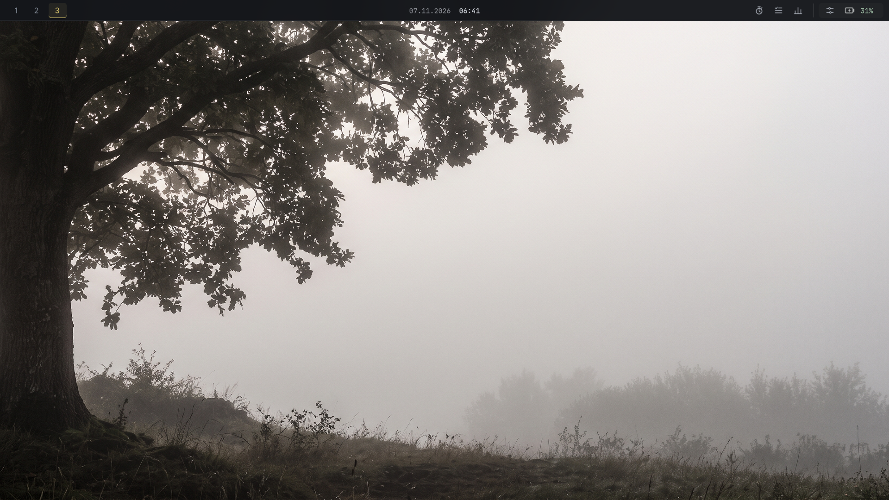
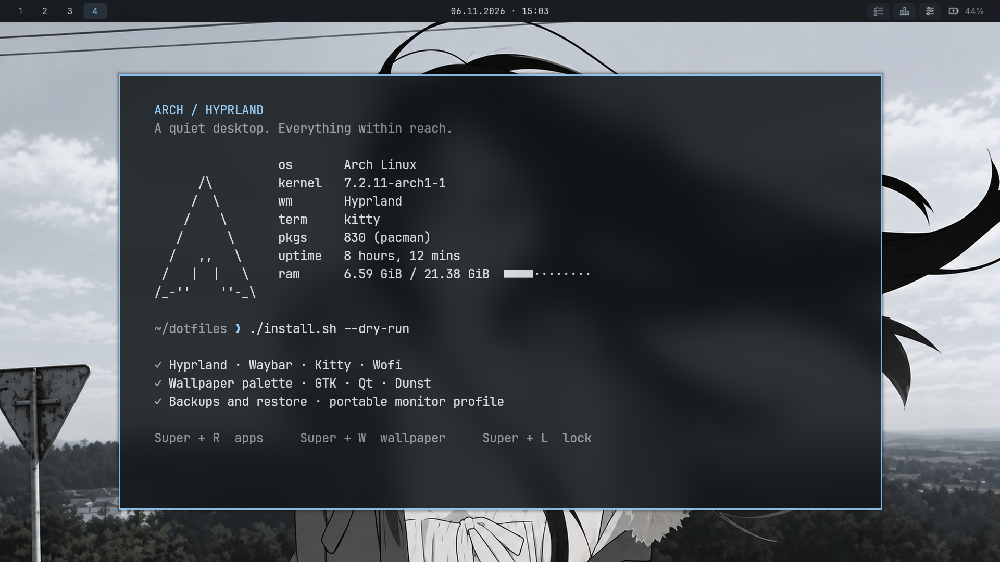
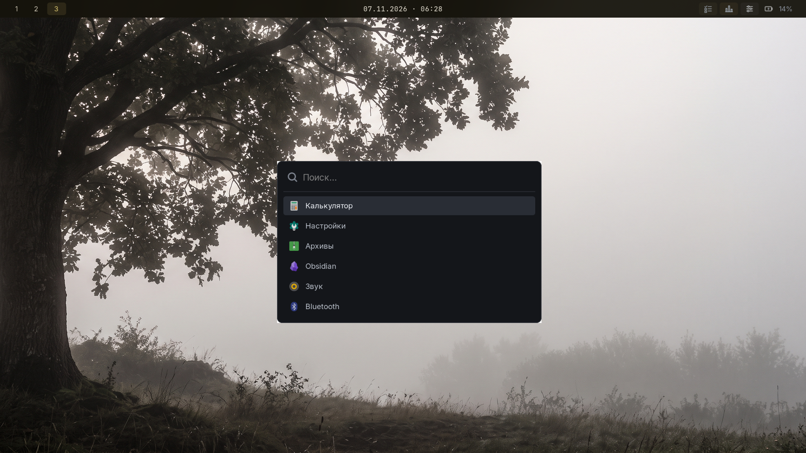
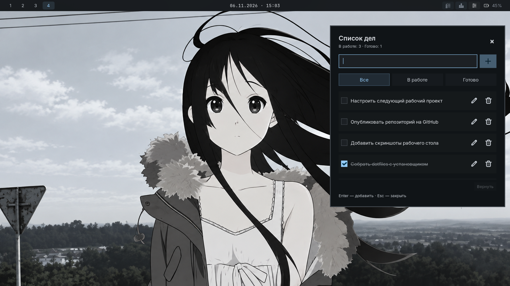
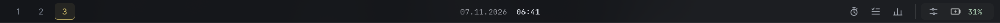

<div align="center">

# ARCH / HYPRLAND

**Спокойный рабочий стол. Всё под рукой.**

Arch Linux · Hyprland · Waybar · Kitty · Matugen

[Установка](#установка) · [Скриншоты](#скриншоты) · [Горячие клавиши](#горячие-клавиши) · [Подробная инструкция](docs/INSTALL.ru.md)

</div>



Тёмные поверхности, прозрачные окна и цвета, которые подстраиваются под обои.
В комплекте — конфиги рабочего стола, установщик с резервными копиями и откатом,
два профиля мониторов и небольшие утилиты для повседневной работы.

Обновлено 7 ноября 2026 года: Waybar прилегает к верхнему краю на всю ширину,
инструменты справа сгруппированы; Wofi — компактный список в одну колонку.
Стартовые обои и палитра соответствуют текущему оформлению рабочего стола.

## Скриншоты

| Kitty + Fastfetch | Меню Wofi |
| --- | --- |
|  |  |

<details>
<summary>Список задач в Waybar</summary>



</details>

Панель крупнее — инструменты и системные настройки собраны в отдельные группы:



Реальные снимки сессии Hyprland, полный экран — 1920×1080. Для меню и списка задач использованы
демонстрационные записи. [Как повторить съёмку](docs/screenshots/README.md).

## Что внутри

| Компонент | Возможности |
| --- | --- |
| Hyprland | Lua-конфиг, рабочие пространства, прозрачность, размытие и жесты |
| Waybar | Компактная панель на всю ширину у верхнего края, часы по центру, группы инструментов и системных настроек справа |
| Центр управления | Звук, яркость, Wi-Fi, Bluetooth, музыка и режим фокуса |
| Обои + Matugen | Выбор изображения и общая палитра для панели, меню, терминала, GTK, Qt и уведомлений |
| Kitty / Wofi / Dunst | Терминал, компактное меню приложений в одну колонку и уведомления |
| Hyprlock / Hypridle | Экран блокировки и блокировка перед сном |
| Установщик | Предпросмотр, копирование файлов, резервная копия, откат и повторный запуск |

## Установка

Скачай репозиторий целиком и открой его папку в терминале. Нужны Arch Linux,
Bash и Python 3. Используется Lua-конфиг Hyprland; исходная версия — **0.57.0**.
Версии остальных компонентов и подробности — в [инструкции](docs/INSTALL.ru.md).

```bash
# Предпросмотр без изменений
./install.sh --dry-run

# Зависимости: отдельный шаг на новой системе Arch
./install.sh --packages

# Конфиги с автоматическим выбором мониторов
./install.sh
```

Установщик запускается от обычного пользователя. Для пакетов он отдельно
вызывает `sudo pacman -Syu --needed`; список находится в [packages.txt](packages.txt).
После установки выйди из Hyprland и войди снова, чтобы применился автозапуск.

| Профиль | Команда | Экраны |
| --- | --- | --- |
| Portable | `./install.sh` | Preferred mode, автоматический масштаб |
| Laptop | `./install.sh --profile laptop` | eDP-1, 1080p, 150%; HDMI-A-1 зеркалирует встроенный экран |

Схему можно изменить в установленном `~/.config/hypr/monitors.lua`.

### Откат

Путь резервной копии выводится при установке. Восстановление:

```bash
./install.sh --restore ~/.local/state/arch-hyprland-dotfiles/backups/ИМЯ-КОПИИ
```

Текущие версии файлов сохраняются в `before-restore/`. Личные базы задач,
статистики и таймера в репозиторий не входят. [Как работают резервные копии](docs/INSTALL.ru.md#резервная-копия-и-откат).

## Горячие клавиши

`Super` — клавиша Windows.

| Сочетание | Действие |
| --- | --- |
| `Super + Q` | Терминал Kitty |
| `Super + R` | Меню приложений |
| `Super + E` | Файловый менеджер Dolphin |
| `Super + B` | Firefox |
| `Super + W` | Обои и палитра |
| `Super + L` | Блокировка |
| `Super + C` | Закрыть окно |
| `Super + V` | Плавающее окно |
| `Super + 1…0` | Переключить рабочее пространство |
| `Super + Shift + 1…0` | Перенести окно |
| `Print` / `Shift + Print` | Скриншот в буфер / в файл |
| `Alt + Shift` | Переключить русский / английский |

## Структура

```text
arch-hyprland-dotfiles/
├── README.md
├── install.sh
├── packages.txt
├── assets/                 # Стартовые обои
├── config/                 # Шаблоны конфигов и утилиты
├── profiles/laptop/        # Исходная схема мониторов
├── docs/
│   ├── INSTALL.ru.md       # Установка, настройки и откат
│   ├── GITHUB.ru.md        # Как загрузить репозиторий
│   └── screenshots/       # Галерея рабочего стола и панели
├── scripts/                # Установщик, съёмка и упаковка
├── tests/                  # Проверки установщика
└── .github/workflows/      # Автоматические проверки
```